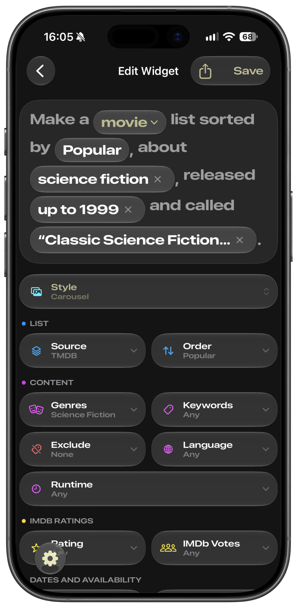
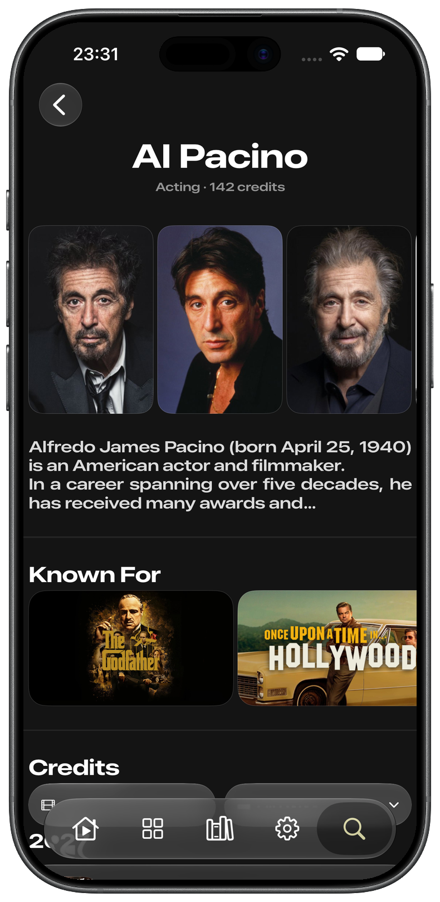

<h1> Blusion <sup>v.1363</sup></h1>

<p></p>

A native SwiftUI media browser and player for iPhone, iPad and Mac, built around Stremio addons and customisable Home widgets.

## Screenshots

<!-- All portrait screenshots use fastlane/frameit-frames, Apple iPhone 17 Black. -->

<table>
  <tr>
    <th width="25%">Home</th>
    <th width="25%" colspan="2">Widgets</th>
    <th width="25%">Advanced stream selection<br><sup>optional</sup></th>
  </tr>
  <tr>
    <td width="25%"></td>
    <td width="25%"></td>
    <td width="25%"></td>
    <td width="25%"></td>
  </tr>
</table>

<table>
  <tr>
    <th width="25%">Search</th>
    <th width="25%">Series</th>
    <th width="25%">People</th>
    <th width="25%">Ratings &amp; reviews</th>
  </tr>
  <tr>
    <td width="25%"></td>
    <td width="25%"></td>
    <td width="25%"></td>
    <td width="25%"></td>
  </tr>
</table>

<table>
  <tr><th width="50%">Movie details</th><th width="50%">Library</th></tr>
  <tr>
    <td width="50%"></td>
    <td width="50%"></td>
  </tr>
</table>

## Features

### Browse

- Movie, series and people search.
- Ratings, reviews and cast filmographies.

### Watch

- Stremio addons and built-in playback.
- Trakt sync.

### Personalise

- Customisable Home widgets, shelves and layouts.

## Build

Requires a Mac, Xcode with the iOS 26 SDK or newer, and [XcodeGen](https://github.com/yonaskolb/XcodeGen).

```bash
brew install xcodegen
./scripts/enable-fallback.sh
open Blusion.xcodeproj
```

Select your development team in Xcode's Signing & Capabilities, choose a device or simulator, then run. The script generates the project with the MPVKit playback engine enabled.

*In active development.*
