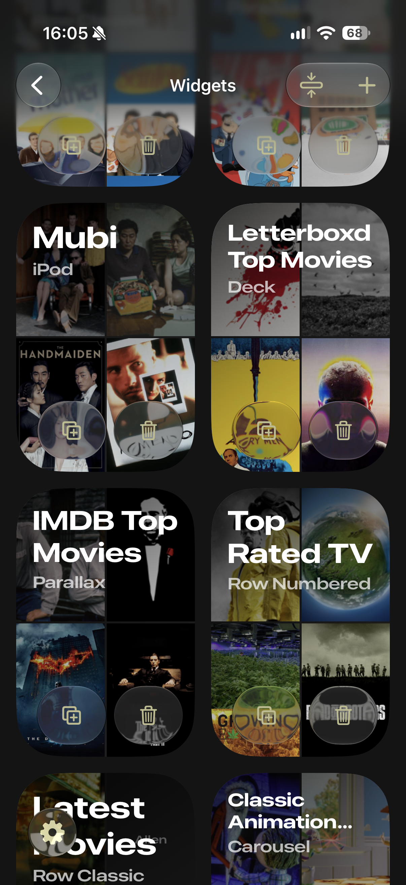
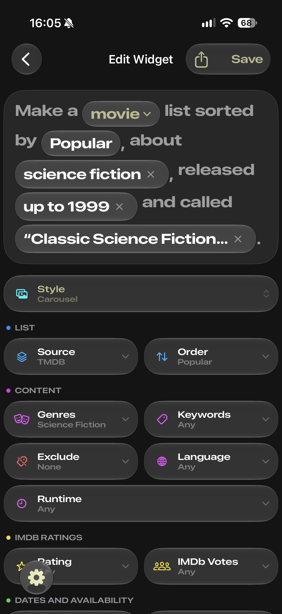
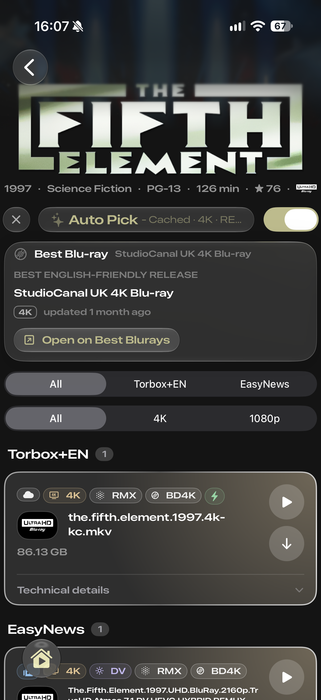
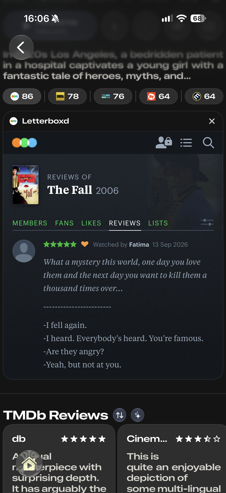

<h1> Blusion <sup>v.1363</sup></h1>

<p></p>

A native SwiftUI media browser and player for iPhone, iPad and Mac, built around Stremio addons and customisable Home widgets.

<p align="center">
  
</p>

## Screenshots

### Home

<p align="center">
  
</p>

### Widgets

<p align="center">
  
  
</p>

### Advanced stream selection <sup>optional</sup>

<p align="center">
  
</p>

### Ratings &amp; reviews

<p align="center">
  
</p>

### Search &amp; discovery

<p align="center">
  
  
  
</p>

### Library

<p align="center">
  
</p>

## Features

### Browse

- Movie, series and people search.
- Ratings, reviews and cast filmographies.

### Watch

- Stremio addons and built-in playback.
- Trakt sync.

### Personalise

- Customisable Home widgets, shelves and layouts.

## Build

Requires a Mac, Xcode with the iOS 26 SDK or newer, and [XcodeGen](https://github.com/yonaskolb/XcodeGen).

```bash
brew install xcodegen
./scripts/enable-fallback.sh
open Blusion.xcodeproj
```

Select your development team in Xcode's Signing & Capabilities, choose a device or simulator, then run. The script generates the project with the MPVKit playback engine enabled.

*In active development.*
