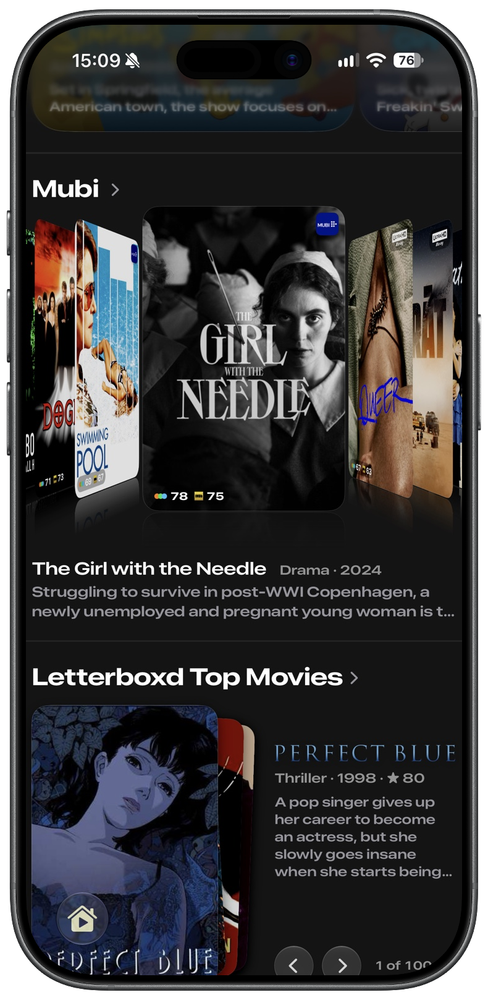
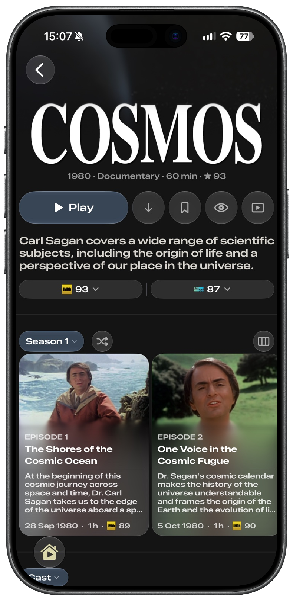
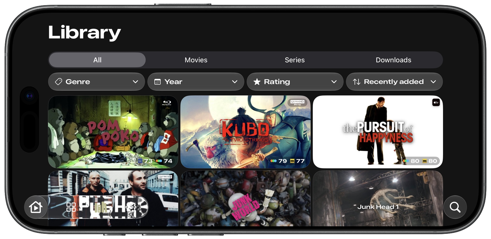

<div align="center">
  <br />
  
  <h1>Blusion<sup>v.1363</sup></h1>
  <p>
    Media browser and player for iPhone, iPad and Mac,<br />
    built around Stremio addons and customisable Home widgets.
  </p>
  <p>
    
  </p>
  <p>
    <a href="https://github.com/Oscarrscso/Blusion/releases/latest"><strong>Latest release</strong></a>
    &nbsp;&nbsp;·&nbsp;&nbsp;
    <a href="#features">Features</a>
    &nbsp;&nbsp;·&nbsp;&nbsp;
    <a href="#more-screenshots">Screenshots</a>
    &nbsp;&nbsp;·&nbsp;
    <a href="#build">Build</a>
  </p>
</div>

<br />


<p align="center">
  
</p>

<p align="center">
  
  
  
  
</p>

## Features

- **Browse** — Movie, series and people search, with ratings, reviews and cast filmographies.
- **Watch** — Stremio addons, built-in playback, of literally any file or format, as well as Trakt sync.
- **Personalise** — Customisable Home widgets, shelves and layouts.

## More screenshots

<p align="center">
  
</p>

<p align="center">
  
  
  
  
</p>

## Build

Requires a Mac, Xcode with the iOS 26 SDK or newer, and [XcodeGen](https://github.com/yonaskolb/XcodeGen).

```sh
brew install xcodegen
./scripts/generate-project.sh
open Blusion.xcodeproj
