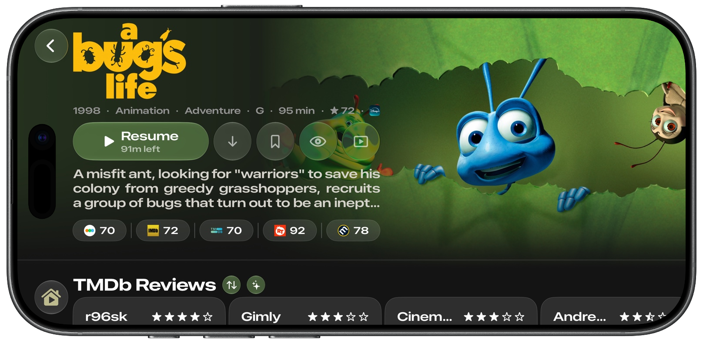
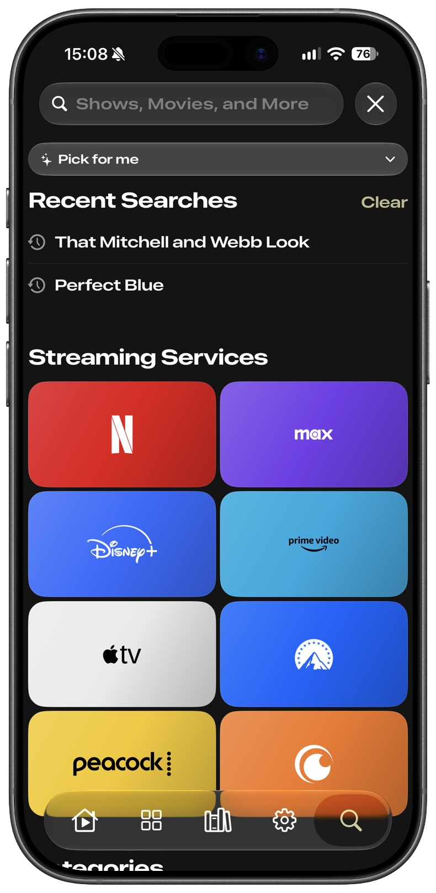

<h1> Blusion v.1422a </h1> 

 
A native SwiftUI media browser and player for iPhone, iPad and Mac, built around Stremio addons and customisable Home widgets.
 
<a href="https://github.com/Oscarrscso/Blusion/releases/tag/v.1422a"><b>Latest release</b></a>
 <!-- All portrait screenshots use fastlane/frameit-frames, Apple iPhone 17 Black. --> 
  
 
     
 <h2>Features</h2> <ul> <li><b>Browse:</b> movie, series and people search, with ratings, reviews and cast filmographies.</li> <li><b>Watch:</b> Stremio addons, built-in playback and Trakt sync.</li> <li><b>Personalise:</b> customisable Home widgets, shelves and layouts.</li> </ul> <h2>More screenshots</h2> 
  
 
     
 <h2>Build</h2> 
Requires a Mac, Xcode with the iOS 26 SDK or newer, and <a href="https://github.com/yonaskolb/XcodeGen">XcodeGen</a>.
 
 <code>brew install xcodegen</code>  <code>./scripts/generate-project.sh</code>  <code>open Blusion.xcodeproj</code> 
 
Select your development team in Xcode's Signing &amp; Capabilities, choose a device or simulator, then run. The script generates the project with both playback engines enabled. Add API credentials in the app’s Settings.
 
<em>In active development.</em>

