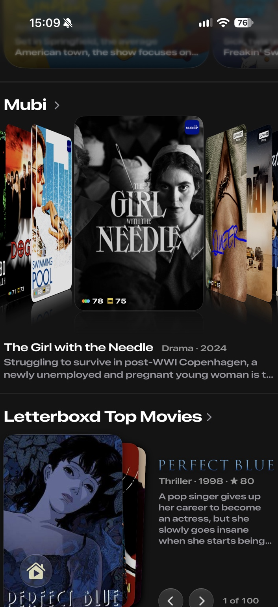
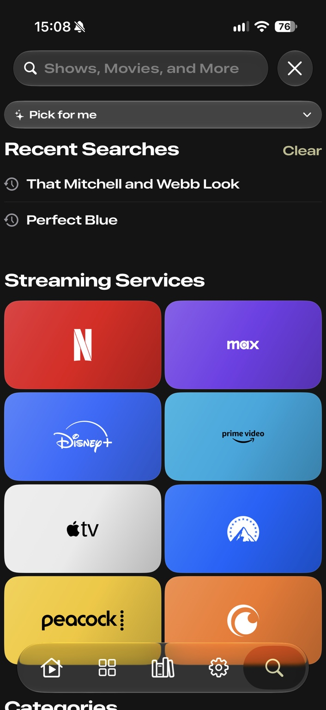
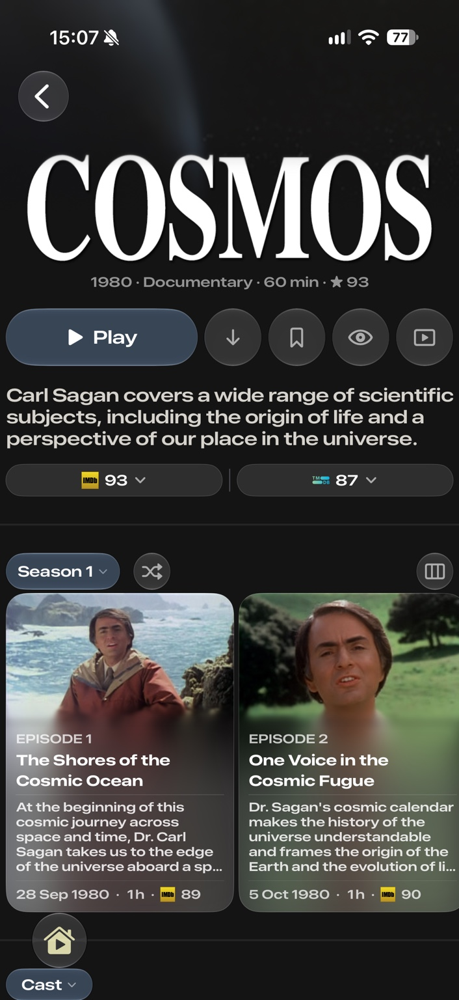
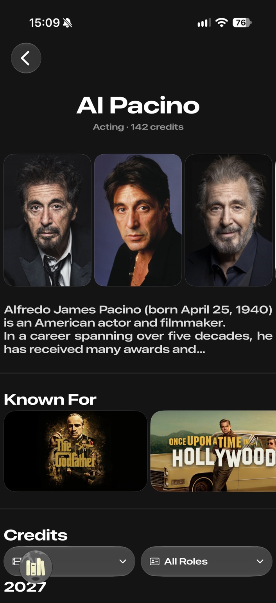
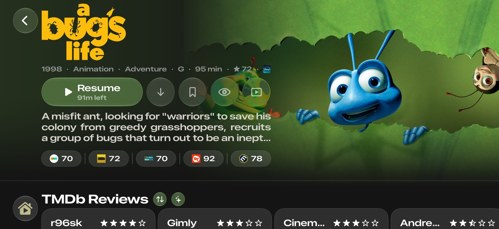
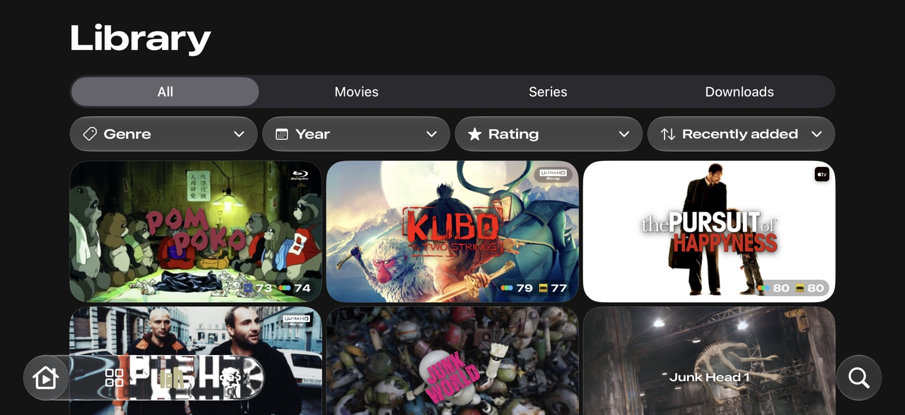

# Blusion

A native SwiftUI media browser and player for iPhone, iPad and Mac, built around Stremio addons and customisable Home widgets.

## Screenshots

<p align="center">
  
  
  
  
</p>
<p align="center">
  
  
</p>

## Features

- Customisable widgets, shelves and layouts.
- Movie, series and people search.
- Ratings, reviews and cast filmographies.
- Stremio addons, built-in playback and Trakt sync.

## Build

Requires a Mac, Xcode with the iOS 26 SDK or newer, and [XcodeGen](https://github.com/yonaskolb/XcodeGen).

```bash
brew install xcodegen
./scripts/enable-fallback.sh
open Blusion.xcodeproj
```

Select your development team in Xcode's Signing & Capabilities, choose a device or simulator, then run. The script generates the project with the MPVKit playback engine enabled.

*In active development.*
